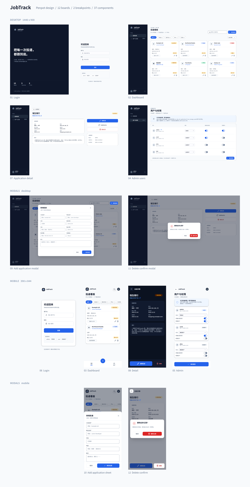

# JobTrack

A job-application tracker. Each user keeps their own applications through a
submission → interview → offer/rejected pipeline; a privileged role can see every
user's applications and manage who holds which role.

## Design

Twelve boards cover every screen at two breakpoints (1440×900 desktop, 390×844
mobile) plus the two dialogs, each at both sizes; a thirteenth frame documents
the component library. The Penpot file is the editable source; the PNGs in
`draft/design/penpot/` are 1× exports.



- `docs/ui-design.md` — board-by-board walkthrough, tokens, components, prototype links
- `docs/wireframe-spec.md` — the written spec each board follows
- `draft/design/penpot/` — one PNG per board

## Stack

| Layer | Choice |
|---|---|
| Language | TypeScript (ESM, `tsc` → `dist/`) |
| Server | Express 5 |
| Views | EJS + Bootstrap 5 |
| Auth | Passport (local) + express-session, `crypto.scrypt` hashing |
| Data | Knex 3 + PostgreSQL |
| Tests | `node:test` + `node:assert` |

## Setup

```bash
npm install
cp .env.example .env      # then set DATABASE_URL (Neon) or the PG* variables
npm run migrate
npm run seed
npm run dev               # http://localhost:3000
```

`npm run build && npm start` runs the compiled output from `dist/`.

## Deploy

**Live: <https://jobtrack.yuen-network.top>** — Render (free web service) +
Neon (Postgres). `render.yaml` is committed, so Render can create the service
from the blueprint. The start command runs `migrate` and `seed` before boot;
both are idempotent.

Step-by-step, environment variables and the free-tier caveats:
[`docs/deploy.md`](docs/deploy.md).

Deploys run through **GitHub Actions**: a push to `main` builds, and only if
that passes does the `deploy` job call Render's Deploy Hook
(`RENDER_DEPLOY_HOOK` secret). Render's own auto-deploy stays `Off`. The
workflow also runs a build-only check on pull requests.

## Scripts

| Script | Does |
|---|---|
| `npm run dev` | `tsx watch` on `src/server.ts` |
| `npm run build` | `tsc`, then copies views into `dist/` |
| `npm start` | runs `dist/server.js` |
| `npm run migrate` | `knex migrate:latest` with `.env` loaded |
| `npm run migrate:make <name>` | new migration |
| `npm run migrate:rollback` | roll back the last batch |
| `npm run seed` / `npm run seed:make` | run / create seeds |
| `npm test` | `node --test` via `tsx` |
| `npm run vendor` | copies Bootstrap into `public/vendor/` (also runs on install) |
| `npm run erd` | `erd.sql → erd.generated.mmd → JobTrack_ERD_P3.png` (needs Chromium on first run) |

## Demo accounts

Seeded by `npm run seed`:

| Username | Password | Role |
|---|---|---|
| `admin` | `admin123` | admin — sees all applications, manages users |
| `alice` | `user123` | user — owns the sample applications |
| `bob` | `user123` | user — empty list, proves the ownership filter |

Passwords come from `DEMO_ADMIN_PASSWORD` / `DEMO_USER_PASSWORD` in `.env` when set;
the values above are local fallbacks. Change them before exposing the app.

## Where things live

- `draft/erd.sql` — executable schema, source of truth for the ERD and migrations
- `docs/erd.md` — readable ERD (Mermaid), rendered by GitHub, carries the rules the diagram can't show
- `draft/erd.generated.mmd` / `draft/JobTrack_ERD_P3.png` — generated by `npm run erd` from `erd.sql`
- `draft/` — the graded artifacts (P1 wireframe, P2 ERD)
- `migrations/`, `seeds/` — TypeScript, loaded by the Knex CLI through `tsx`
  (`extension: "ts"` in `knexfile.js`); no compiled JS is checked in
- `src/` — application code
- `CONTEXT.md` — domain glossary; read this before naming anything
- `docs/scope.md` — assessment map and syllabus coverage
- `docs/lanes.md` — who owns which files
- `materials/` — course PDFs (git-ignored)
