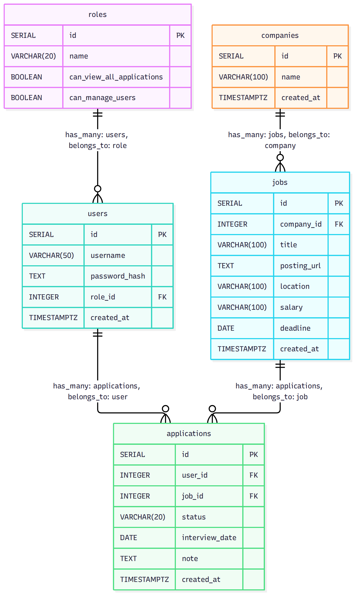
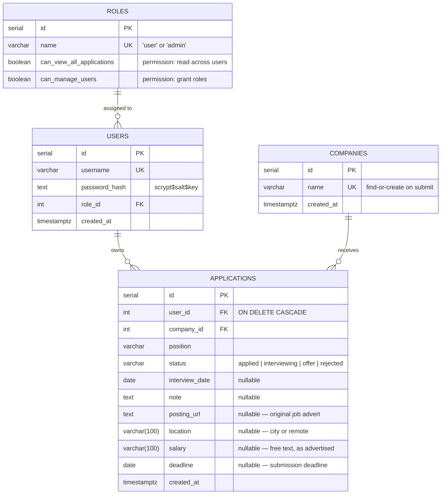

# ERD — JobTrack

The executable source is [`draft/erd.sql`](../draft/erd.sql); this file is the
readable version. GitHub renders the block below as a diagram.

*`draft/JobTrack_ERD_P3.png` — rendered from `draft/erd.sql` by `npm run erd`
(4 tables, 3 relations).*

## Rules the diagram doesn't show

- **Status** is constrained by a `CHECK` in the migration, not just by the UI.
  Display labels live in the view layer; the database stores the four codes.
- **Ownership governs writes.** A role may grant visibility across users, but
  nobody edits or deletes an application they don't own — not even admin.
- **Reads are permission-based.** `can_view_all_applications` controls whether
  the list query filters on `user_id`.
- **Companies are shared.** `name` is unique, so adding an application finds or
  creates its company instead of inserting a duplicate.
- **Posting details live on the application**, not in a separate Posting entity.
  A personal tracker has no need to share one posting row across users; each user
  keeps their own copy of the advert's URL, location, salary and deadline.
- **Indexes** on `applications.user_id`, `.company_id`, and `.status` back the
  filtered list and the `GROUP BY status` statistics.
- **Seed rule:** `admin` gets both permissions, `user` gets neither, and exactly
  one `admin` account exists by default.
