# ERD — JobTrack

The executable source is [`draft/erd.sql`](../draft/erd.sql); this file is the
readable version. GitHub renders the block below as a diagram, and
`npm run erd` renders the same schema to `draft/JobTrack_ERD_P3.png`.

```mermaid
erDiagram
    COMPANIES ||--o{ JOBS : "posts"
    JOBS ||--o{ APPLICATIONS : "tracked by"
    USERS ||--o{ APPLICATIONS : "applies"
    ROLES ||--o{ USERS : "assigned to"

    ROLES {
        serial id PK
        varchar name UK "'user' or 'admin'"
        boolean can_view_all_applications "permission: read across users"
        boolean can_manage_users "permission: grant roles"
    }

    USERS {
        serial id PK
        varchar username UK
        text password_hash "scrypt$salt$key"
        int role_id FK "every user holds exactly one role"
        boolean can_view_all_applications "per-user override, NULL = follow role"
        boolean can_manage_users "per-user override, NULL = follow role"
        timestamptz created_at
    }

    COMPANIES {
        serial id PK
        varchar name UK "find-or-create on job creation"
        timestamptz created_at
    }

    JOBS {
        serial id PK
        int company_id FK
        varchar title
        text posting_url "nullable — original advert"
        varchar location "nullable — city or remote"
        varchar salary "nullable — free text, as advertised"
        date deadline "nullable — submission deadline"
        timestamptz created_at
    }

    APPLICATIONS {
        serial id PK
        int user_id FK "ON DELETE CASCADE"
        int job_id FK "ON DELETE CASCADE"
        varchar status "applied | interviewing | offer | rejected"
        date interview_date "nullable"
        text note "nullable"
        timestamptz created_at
    }
```

`applications` is the **join table** between `users` and `jobs`: one row per
(user, job) pair, `UNIQUE (user_id, job_id)`. A posting is stored once in `jobs`
and every user tracking it points at that row — two people applying to the same
advert share its URL, salary and deadline but keep their own status and notes.

## Rules the diagram doesn't show

- **Status** is constrained by a `CHECK` in the migration, not just by the UI.
  Display labels live in the view layer; the database stores the four codes.
- **Ownership governs writes.** A role may grant visibility across users, but
  nobody edits or deletes an application they don't own — not even admin.
- **Reads are permission-based.** `can_view_all_applications` controls whether
  the list query filters on `user_id`.
- **One application per posting per user.** The unique pair keeps a second
  "apply" from silently duplicating the row; deleting the application leaves the
  job (and other users' applications) intact.
- **Companies are shared.** `name` is unique, so creating a job finds or creates
  its company instead of inserting a duplicate.
- **Jobs are shared, applications are personal.** Editing an advert's salary in
  `jobs` changes it for everyone tracking that posting; per-user state lives in
  `applications` only.
- **Indexes** on `jobs.company_id` and `applications.user_id`, `.job_id`,
  `.status` back the filtered list, the join and the `GROUP BY status` counts.
- **Seed rule:** `admin` gets both permissions, `user` gets neither, and exactly
  one `admin` account exists by default.
- **Permissions are role-default with per-user override.** The role's booleans
  are the defaults every account starts with; `/admin/users` can grant or
  revoke either permission for one user, writing the two nullable override
  columns on `users`. Guards read `COALESCE(user.col, role.col)`; clearing the
  override returns the account to its role's default.
