# JobTrack UI design

> **Penpot 文件：** `JobTrack`，页面 `JobTrack P1 v4`
>
> **直接打开（查看视图）：**
> <https://design.penpot.app/?screen=viewer&file-id=b4b906dd-9024-819c-8008-f4673c7ac5e7&page-id=b4b906dd-9024-819c-8008-f4673c7ac5e8&section=interactions&index=0>
>
> **公开链接：** 提交以本目录导出的 PNG 为准（无需账号）；在线查看用上面的 viewer 链接。
>
> **画板导出 PNG：** [`draft/design/penpot/`](../draft/design/penpot)，12 张画板图
> （1:1 实际尺寸：1440×900 / 390×844）+ 1 张总览板；`dark/` 下是同名的暗色一套。

This is the **final UI design** for JobTrack, as shipped. Twelve boards cover
every screen at both breakpoints (1440×900 desktop, 390×844 mobile) including
the two dialogs, each at both sizes; the card grid reflows from 3 columns to
one, the admin table becomes stacked user cards, and the detail page drops its
right rail into a bottom action bar. The component masters live on the file's
`Components` page and are not duplicated on the screens page.

The shipped app follows these boards. Two deliberate additions landed after the
boards were drawn: a tri-state theme toggle in the shell (system / light /
dark — the `dark/` set above is the pinned-dark rendering), and rem-based
sizing (477 px tokens ÷16) so the layout scales with the user's root font size
instead of only zooming. Dialogs use native `<dialog>` with light dismiss
(`closedby`), focus on the safe action (取消), and overscroll containment.

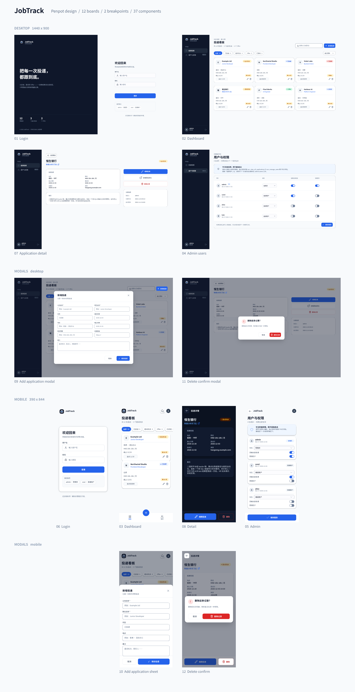

*`00-overview.png` — every board at a glance. The Penpot viewer shows one board
at a time; this is the whole design in a single image.*

| # | Board | Purpose |
|---|---|---|
| 01 | Login — Desktop | entry point, demo accounts, error state |
| 02 | Dashboard — Desktop | search, status filters, application card grid |
| 03 | Dashboard — Mobile | same dashboard, single column + tab bar / FAB |
| 04 | Admin Users — Desktop | user rows, role select, two permission toggles |
| 05 | Admin Users — Mobile | same admin screen, stacked cards, save bar |
| 06 | Login — Mobile | mobile entry point, same fields and demo accounts |
| 07 | Application Detail — Desktop | full notes, meta grid, edit / source / delete |
| 08 | Application Detail — Mobile | same detail, stacked meta + bottom action bar |
| 09 | Add Application — Modal — Desktop | 720×660 form over the dimmed dashboard |
| 10 | Add Application — Modal — Mobile | same form as a bottom sheet |
| 11 | Delete Confirm — Modal — Desktop | 420×210 confirm over the detail page |
| 12 | Delete Confirm — Modal — Mobile | same confirm, centred card |

Counts live in the status filter chips (`全部 / 已投递 / 面试机会 / Offer /
已拒绝`). The earlier KPI row repeated the same numbers, so it was removed
rather than shown twice.

## Boards

Every frame carries a `PNG · 1x` export entry, so a board can be selected and
exported straight from the Penpot right-hand panel. The checked-in copies in
`draft/design/penpot/` were produced that way — no resampling, no cropping.

### 01 · Login — Desktop

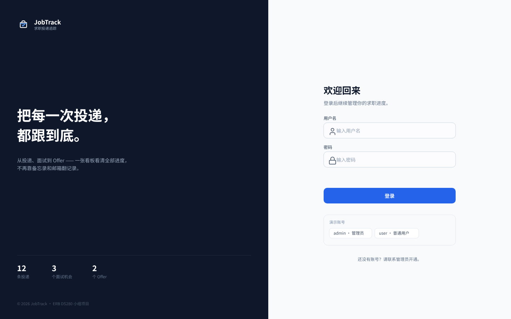

`01-login-desktop.png` · 1440×900

### 02 · Dashboard — Desktop

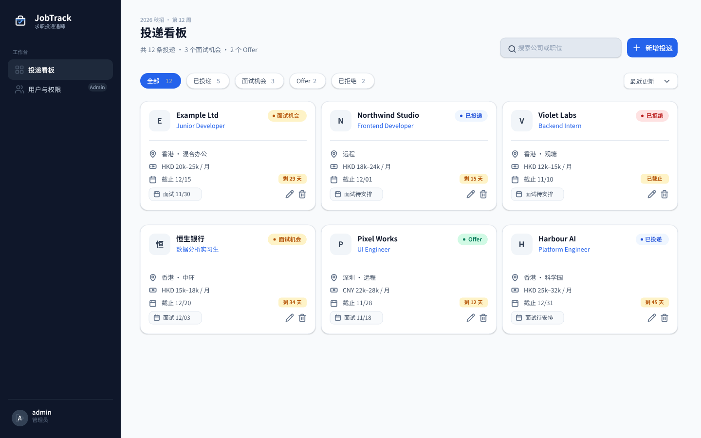

`02-dashboard-desktop.png` · 1440×900

### 03 · Dashboard — Mobile

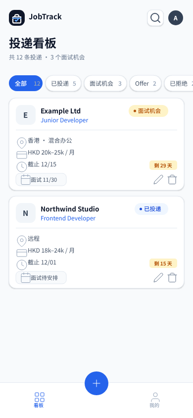

`03-dashboard-mobile.png` · 390×844

### 04 · Admin Users — Desktop

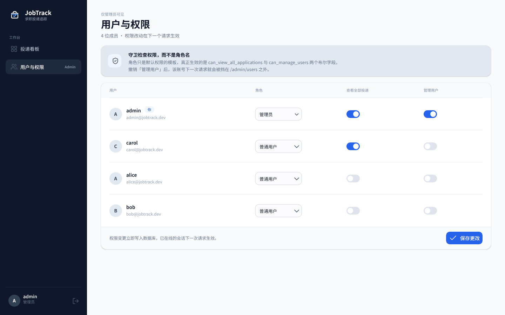

`04-admin-users-desktop.png` · 1440×900

### 05 · Admin Users — Mobile


`05-admin-users-mobile.png` · 390×844

### 06 · Login — Mobile


`06-login-mobile.png` · 390×844

### 07 · Application Detail — Desktop

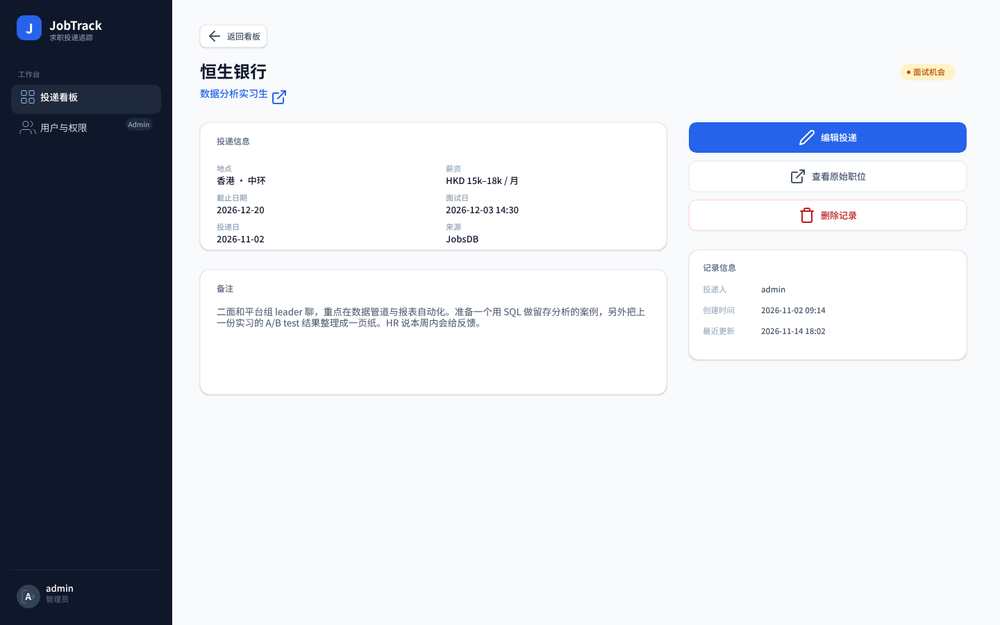

`07-application-detail-desktop.png` · 1440×900

### 08 · Application Detail — Mobile

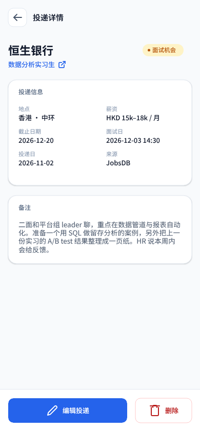

`08-application-detail-mobile.png` · 390×844

### 09 · Add Application — Modal — Desktop

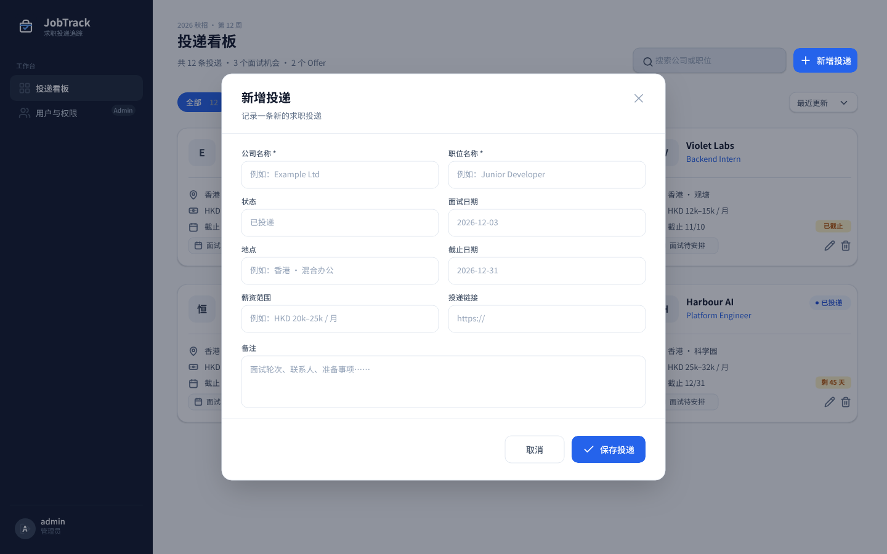

`09-add-application-modal-desktop.png` · 1440×900

### 10 · Add Application — Modal — Mobile

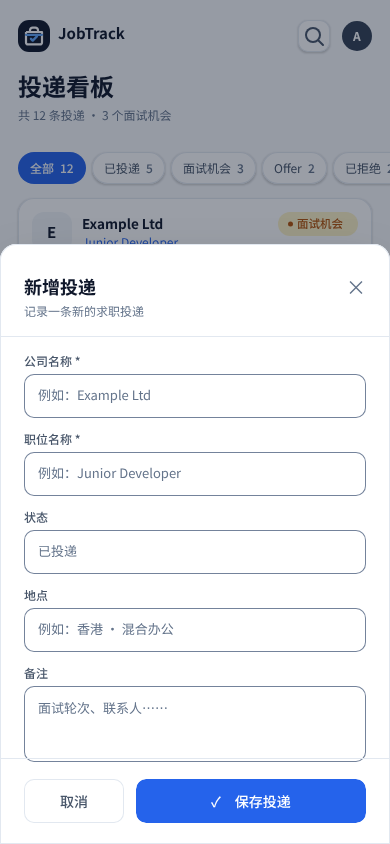

`10-add-application-modal-mobile.png` · 390×844

### 11 · Delete Confirm — Modal — Desktop

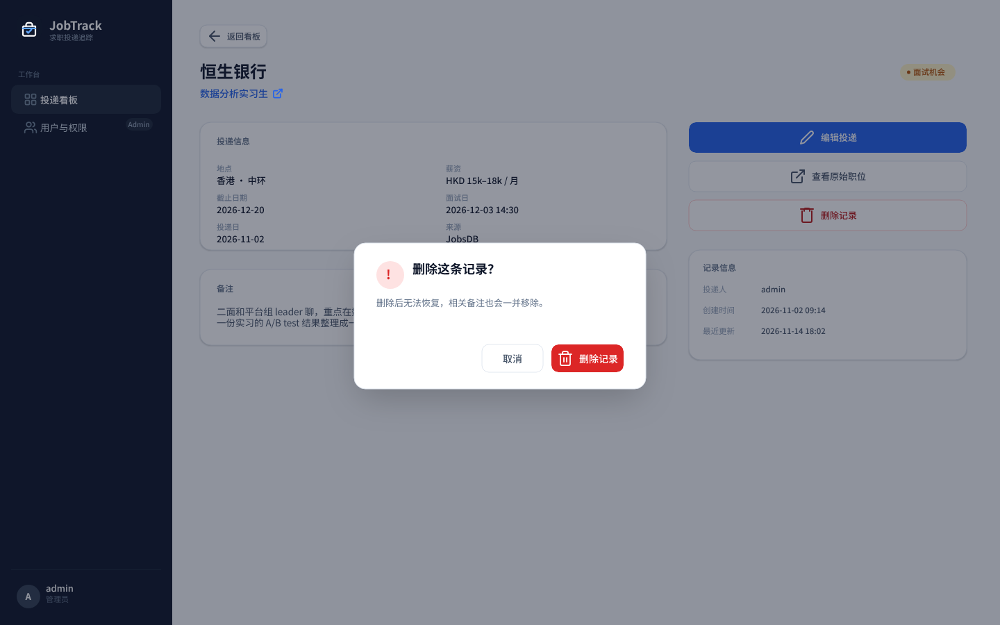

`11-delete-confirm-modal-desktop.png` · 1440×900

### 12 · Delete Confirm — Modal — Mobile

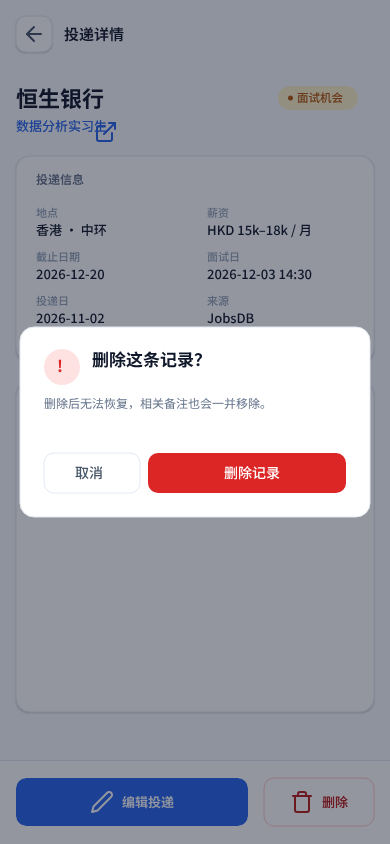

`12-delete-confirm-modal-mobile.png` · 390×844

`00-overview.png` (1388×2700) is exported from the `00 Overview — All Boards`
board itself: desktop 2×2, the two desktop dialogs, the mobile row, then the
two mobile dialogs. Each cell is an image fill taken from the latest per-board
export; refresh both overviews whenever a board changes. Its dark
twin, `00 Overview — Dark`, carries the same 12 cells in the same positions and
is exported to `dark/00-overview.png`.

## Design tokens

The Penpot file has a `JobTrack Core` token set plus two colour sets:

```text
JobTrack Core   50 shared tokens (typography, radius, spacing, sizing, weights, on-dark colours)
Light           29 colour tokens (light values)
Dark            29 colour tokens (dark values, same names)
themes          Light = [Core, Light]   Dark = [Core, Dark]
```

Shapes bind **by token name** (e.g. `color-surface`), so switching the theme
re-resolves every fill, stroke and text colour without duplicating boards.
Typography composites: `type-h1/h2/title/body/body-medium/meta/meta-medium`.

| Token | Value |
|---|---|
| `canvas` | `#F8FAFC` |
| `surface` | `#FFFFFF` |
| `line` | `#E2E8F0` |
| `control-line` (input borders) | `#74839B` |
| `switch-off` / `switch-knob` | `#74839B` / `#FFFFFF` |
| `ink` / `body` / `muted` / `faint` | `#0F172A` / `#475569` / `#64748B` / `#64748B` |
| `brand` / `brand-soft` | `#2563EB` / `#EFF6FF` |
| applied | `#EFF6FF` / `#1D4ED8` |
| interviewing | `#FEF3C7` / `#B45309` |
| offer | `#D1FAE5` / `#047857` |
| rejected | `#FEE2E2` / `#B91C1C` |
| radius | 6 / 10 / 12 / 16 / pill |
| icon scale | 16 inline · 18 nav/input · 20 tab bar · 24 FAB |

Two theme-independent colours sit in `JobTrack Core`, not in the colour sets,
because the shell they cover never changes with the theme:

| Token | Value | Used by |
|---|---|---|
| `on-dark` | `#F8FAFC` | active filter chip label + count |
| `on-dark-muted` | `#94A3B8` | sidebar section label, Admin badge, user role, login pitch / stat labels, copyright |

The shell's primary text (brand, active nav label, username, login headline and
stat values) stays literal `#FFFFFF` at 17.85:1, and the idle nav label is
`#CBD5E1` at 12.02:1 — both already clear AA without a token.

Text and UI contrast was measured against WCAG AA: body `#475569` 7.6:1, muted/faint
`#64748B` 4.8:1, white on brand `#2563EB` 5.2:1, white on danger `#DC2626` 4.8:1, and all
four status pills 4.5–6.2:1. The former `#94A3B8` faint tone was retired from the light
palette (2.6:1 on white) and survives only as `on-dark-muted` on the `#0F172A` shell,
where it measures 6.96:1. Control borders (`#74839B`) and the switch off-track clear
the 3:1 non-text minimum as well.

## Dark mode

`Light` dominates the deliverable; `dark/` holds the same 12 boards exported with
the `Dark` theme active. The palettes are token values, so both sets come from the
same boards:

| Role | Light | Dark |
|---|---|---|
| canvas | `#F8FAFC` | `#0B1220` |
| surface | `#FFFFFF` | `#111A2E` |
| elevated (dialogs) | `#FFFFFF` | `#18233A` |
| ink | `#0F172A` | `#F1F5F9` |
| body | `#475569` | `#CBD5E1` |
| muted | `#64748B` | `#94A3B8` |
| line / line-strong | `#E2E8F0` / `#CBD5E1` | `#1E2A44` / `#334155` |
| brand | `#2563EB` | `#2563EB` |
| brand-text (links, roles) | `#2563EB` | `#60A5FA` |
| control-line (input border) | `#74839B` | `#74839B` |
| switch off-track / knob | `#74839B` / `#FFFFFF` | `#74839B` / `#FFFFFF` |
| ok / warn / bad | `#047857` / `#B45309` / `#B91C1C` | `#34D399` / `#FBBF24` / `#F87171` |

The sidebar and the login brand panel keep a fixed `#0F172A` background in both
modes; only their secondary text swaps to the theme-independent `on-dark-muted`,
because the theme's `muted` (`#64748B`) only reaches 3.75:1 on that navy — close
enough to look intentional, far enough to fail AA at 11–14px.

### Contrast

Every text pair clears WCAG AA (4.5:1) and every control boundary clears the
non-text minimum (3:1). Worst-case pairs, measured from the token values:

| Pair | Light | Dark |
|---|---|---|
| ink on canvas / surface | 17.06 / 17.85 | 17.09 / 15.83 |
| body on surface | 7.58 | 11.68 |
| muted on surface | 4.76 | 6.76 |
| white on brand | 5.17 | 5.17 |
| white on danger | 4.83 | 4.83 |
| link / role text on surface | 5.17 | 6.82 |
| status text on its soft fill | 4.51–6.16 | 5.06–8.97 |
| input border (`color-control-line`) | 3.84 | 4.51 |
| switch off-track vs surface | 3.84 | 4.51 |
| switch knob vs off-track | 3.84 | 3.84 |
| switch on-track / knob | 5.17 | 5.17 |
| sidebar secondary text (`on-dark-muted` on `#0F172A`) | 6.96 | 6.96 |
| active chip label / count (`on-dark` on brand) | 4.94 | 4.94 |

Five adjustments came out of this pass: links moved off `color-brand` onto a
separate `color-brand-text` (dark `#60A5FA`, 6.82:1), the input border moved off
`line` onto `color-control-line` `#74839B` (because `#E2E8F0` on white is 1.23:1
and `#1E2A44` on the dark field is 1.25:1 — neither is a visible boundary), and
switch knobs moved off `color-surface` onto a fixed `color-switch-knob`, which
had turned the knob `#111A2E` on a `#334155` track (1.5:1) in dark mode. The
active filter chip's label and count were still grey on blue (1.09:1) and now
use `on-dark` (4.94:1), and the shell's secondary text moved onto
`on-dark-muted` (3.75:1 → 6.96:1). Two fills were also corrected: the search
field was bound to `color-line` (a grey block in light mode) and now uses
`color-surface`, and the admin banner moved to `color-brand-soft` with
`color-body` copy so its explanation is 7.58:1 instead of 3.86:1.

`draft/design/penpot/dark/` mirrors the light exports, including its own
`00-overview.png`; both overviews are generated by switching the theme and
re-exporting, never by hand.

The runtime honours the same two themes without depending on JS for rendering.
`<meta name="color-scheme">` is the source of truth: the base declaration is
`light dark` (system), a pre-paint script only writes the stored override into
the meta, and `app.css` maps it back with `:has()`. The Dark token set is
written twice — once under
`@media (prefers-color-scheme: dark) :root:has(meta[name="color-scheme"]:not([content="light"]))`
and once pinned under `meta[content="dark"]` — so both the system and the
override paths render before any JS runs. The shell's sun/moon toggle is
tri-state (system → light → dark), persists the override in `localStorage`,
syncs across tabs via the `storage` event, and applies before first paint — no
flash.

## Screen notes

- **Position is a link** (`Junior Developer ↗`) pointing at `posting_url`; when
  empty it renders as plain text.
- **Status badge labels**: `已投递`, `面试机会`, `Offer`, `已拒绝`. The stored codes
  remain `applied | interviewing | offer | rejected` — `面试机会` is only the
  display label for `interviewing` (an interview is an event/opportunity, not a
  continuous process).
- **Meta line** shows location · salary · deadline, omitting empty values.
- **Delete** is confirm-then-AJAX, no page reload.
- **Admin** sees every user's cards with a username label; a normal user sees
  only their own. Writes are always ownership-based.
- **`/admin/users`** is the visible "grant" demo: role + two permission toggles.

## Component library

The component **masters** live on the file's `Components` page (hidden in view
mode); the screens page only carries instances. The `Components` page is laid
out on a 1200px grid as labelled white panels: `BUTTONS`, `PAGE BUTTONS`,
`SHELLS`, `INPUTS`, `NAV & BRAND`, `ICONS`, and `STATUS BADGES`.

Badges are real components and every badge on every screen is an instance:

| Component | Variants on boards |
|---|---|
| `badge-applied-v2` | `已投递` |
| `badge-interviewing-v2` | `面试机会` |
| `badge-offer-v2` | `Offer` |
| `badge-rejected-v2` | `已拒绝` |

The `Components` page holds ten more masters, each built from the same tokens
(`10px` radius, `44px` control height, `13px` label). The three icon buttons
are a real interactive variant set with `Variant` and `State` properties:
`Normal`, `Hover`, and `Disabled`.

| Component | Used for |
|---|---|
| `button-with-icon-variants` | Primary / Save / Danger buttons; `Variant` × `State` (`Normal` / `Hover` / `Disabled`) |
| `chip-filter-active` / `chip-filter-idle` | status filter chips with counts |
| `field-text` / `field-select` | form fields (label + control + placeholder) |
| `switch-toggle` | admin permission toggles |
| `nav-item-active` | sidebar row in its active state |
| `modal-shell` | dialog frame: card, title, divider, footer |
| `drawer-shell` | mobile bottom sheet with grabber, rounded top and footer |
| `app-icon` | shared briefcase + progress-check brand mark |

That is 37 component sets in the file library: 19 icon components, 3 state-variant button sets (9 states), 3 single button components used by the pages (`btn-primary` / `btn-save` / `btn-danger`), and the badges, chips, fields, shells and app icon.
Component boards on the `Components`
page are marked "hide in view mode", so the viewer only shows screens and the
two dialogs.

Icons come from **Lucide** (`lucide-static`, a dev dependency): every icon in the
file is a component built from the package's 24×24 SVG at `1.75px` stroke, so the
design and the markup can be traced back to the same source instead of
hand-drawn paths.

`public/css/app.css` holds the matching tokens and component styling, so the
design maps 1:1 onto the implementation.

## Prototype interactions

Wired with `shape.addInteraction('click', { type: 'navigate-to', destination })`:

| From | Click target | To |
|---|---|---|
| 01 Login — Desktop | `登录` | 02 Dashboard — Desktop |
| 06 Login — Mobile | `登录` | 03 Dashboard — Mobile |
| 02 Dashboard — Desktop | `用户与权限` (icon, label, Admin badge) | 04 Admin Users — Desktop |
| 04 Admin Users — Desktop | `投递看板` (icon, label) | 02 Dashboard — Desktop |
| 02 / 04 | sidebar logout icon | 01 Login — Desktop |
| 03 Dashboard — Mobile | `我的` tab (icon, label) | 05 Admin Users — Mobile |
| 05 Admin Users — Mobile | `← 返回` | 03 Dashboard — Mobile |
| 02 Dashboard — Desktop | `新增投递` | 09 Add Application — Modal — Desktop |
| 09 Add Application — Desktop | close / cancel / save | 02 Dashboard — Desktop |
| 03 Dashboard — Mobile | FAB `+` | 10 Add Application — Modal — Mobile |
| 10 Add Application — Mobile | close / cancel / save | 03 Dashboard — Mobile |
| 02 Dashboard — Desktop | first application card | 07 Application Detail — Desktop |
| 03 Dashboard — Mobile | first application card | 08 Application Detail — Mobile |
| 07 Application Detail — Desktop | `删除记录` | 11 Delete Confirm — Modal — Desktop |
| 11 Delete Confirm — Desktop | cancel / confirm | 07 Application Detail — Desktop |
| 08 Application Detail — Mobile | `删除` | 12 Delete Confirm — Modal — Mobile |
| 12 Delete Confirm — Mobile | cancel / confirm | 08 Application Detail — Mobile |

To add more, select a shape in Penpot and drag its interaction handle to the
target board, or use the `execute_code` MCP tool with `addInteraction`.

## Handoff to P1

After implementing the screens, capture the real pages at desktop and mobile
widths and save as `draft/JobTrack_Wireframe_P1_v4.png`, keeping v3 for history.
That satisfies rubric D's "wireframe followed or updated throughout".
